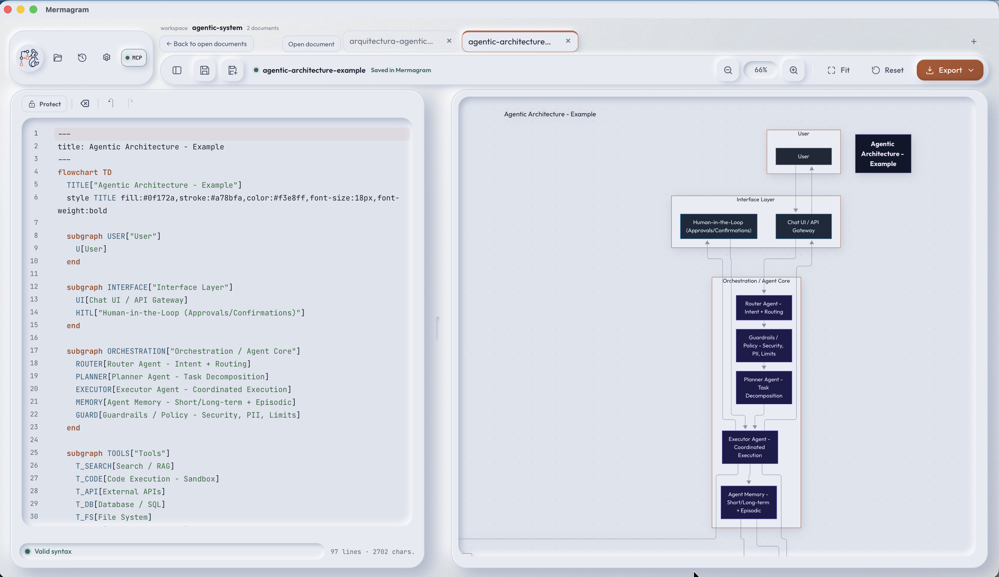

# Mermagram

**Versión en español:** [Leer este README en español](README.md)



Mermagram is a desktop editor and viewer for [Mermaid](https://mermaid.js.org/) diagrams. It is built with **Rust, Tauri v2, TypeScript, and Vite**.

## Features

- CodeMirror 6 editor with Mermaid syntax highlighting, line numbers, and live syntax diagnostics.
- Interactive viewer with zoom, pan, fit-to-canvas, and view reset. Shortcuts: `⌘+`, `⌘-`, `⌘0`, and `⇧F`.
- Export diagrams to **SVG**, **PNG**, and **PDF**.
- Save files through the native system dialog in the desktop app; download files in the browser.
- Draft and preferences are stored locally and restored at startup. Use `?reset=1` to clear the saved draft.
- Localized interface in Spanish, English, French, Italian, Catalan, German, and Simplified Chinese.
- On narrow screens, the editor opens as a slide-out drawer.

## Local MCP workspaces

Mermagram provides an **optional, local-only** MCP server over Streamable HTTP. It stays off until enabled with the **MCP** control, is available only while the app is open, and listens on `127.0.0.1` (default port `38641`). Preferences lets you change the port and copy the endpoint, usually `http://127.0.0.1:38641/mcp`. Register that endpoint explicitly in your agent's MCP configuration; discovery is not automatic.

You can enter a fixed port or choose an available one; a selected port is saved and reused on later launches. If that port is occupied at startup, Mermagram reports the error instead of silently changing the endpoint.

An agent must request access, and you must approve the workspace in the app. Each connection is scoped to one workspace; reject unexpected requests and stop the server when you are done. Workspaces and documents live in application data, not as Mermaid files on disk. Use Save/Save As to explicitly create a physical file. Agent updates replace the complete document and are applied only after Mermaid validation/rendering succeeds; protected documents reject future agent writes.

## General prerequisites

- Node.js 20 or later and npm.
- [Stable Rust](https://www.rust-lang.org/tools/install).
- The native tools required by your operating system, listed below.

### macOS

Install Xcode Command Line Tools:

```sh
xcode-select --install
```

### Windows

- Windows 10 or 11.
- [Microsoft C++ Build Tools](https://visualstudio.microsoft.com/visual-cpp-build-tools/) with the **Desktop development with C++** workload.
- WebView2 Runtime. It is usually preinstalled on Windows 10 and 11.
- Rust with the MSVC toolchain; follow the Rust installation instructions for Windows.

### Debian Linux

Install Tauri/WebKitGTK native dependencies and build tools:

```sh
sudo apt update
sudo apt install build-essential curl wget file libwebkit2gtk-4.1-dev \
  libxdo-dev libssl-dev librsvg2-dev libayatana-appindicator3-dev patchelf
```

## Development

From the repository root, install the JavaScript dependencies and launch the desktop app:

```sh
npm install
npm run tauri dev
```

To run only the frontend in a browser, without the Tauri shell:

```sh
npm run dev
```

To build only the frontend:

```sh
npm run build
```

Run backend persistence and integration tests with `cargo test --manifest-path src-tauri/Cargo.toml`. CI builds and tests the frontend and backend on macOS, Windows, and Linux.

## Build and distribution

Desktop bundles should be built on the target operating system or on a CI runner using that operating system. Builds depend on each platform's native WebView and tooling; cross-compilation from a different operating system is not promised.

On each platform, create an optimized build and distribution bundles with:

```sh
npm run tauri build
```

Artifacts are generated under `src-tauri/target/release/bundle/`:

| Platform | Expected packages | Directory |
| --- | --- | --- |
| macOS | `.app` application and, when enabled by the environment, a `.dmg` image | `macos/` and `dmg/` |
| Windows | `.msi` and/or `.exe` (NSIS) installer | `msi/` and `nsis/` |
| Debian Linux | `.deb` package; AppImage if produced by the packaging environment | `deb/` and `appimage/` |

The native save dialog requires the desktop app. In a browser, Mermagram downloads exported files.

## Project structure

```text
src/
  core/        state, Mermaid, preferences, and persistence
  features/    editor, viewer, layout, export, and menus
  platform/    native and browser save integrations
  styles/      styles, themes, responsive layout, and fonts
src-tauri/     Rust shell and Tauri configuration
resources/     header images and project assets
openspec/      change proposals and specifications
```
