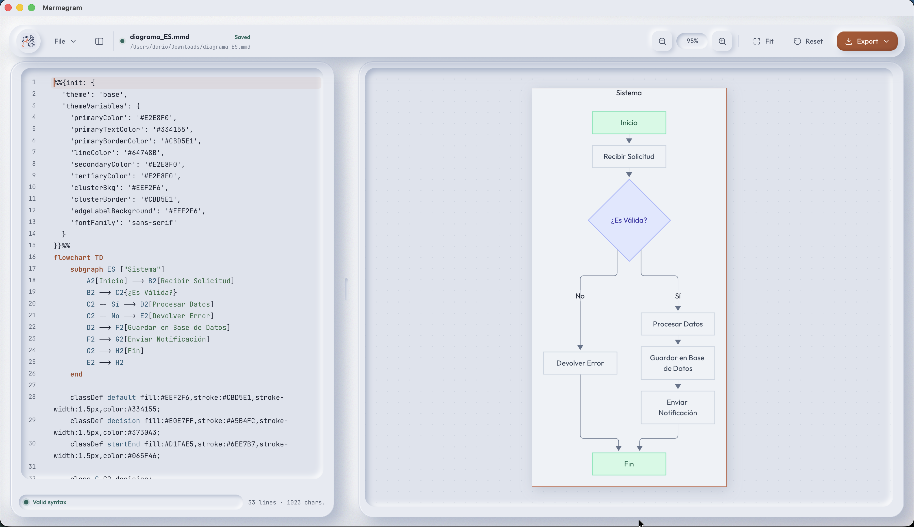

# Mermagram

**English version:** [Read this README in English](README.en.md)



Mermagram es un editor y visor de diagramas [Mermaid](https://mermaid.js.org/) para escritorio. Está construido con **Rust, Tauri v2, TypeScript y Vite**.

## Características

- Editor con CodeMirror 6: resaltado Mermaid, números de línea y diagnósticos de sintaxis en vivo.
- Visor interactivo con zoom, paneo, ajuste al lienzo y restablecimiento de vista. Atajos: `⌘+`, `⌘-`, `⌘0` y `⇧F`.
- Exportación de diagramas a **SVG**, **PNG** y **PDF**.
- Guardado de archivos mediante el diálogo del sistema en la aplicación de escritorio; descarga de archivos en el navegador.
- Borrador y preferencias guardados localmente y restaurados al iniciar. Usa `?reset=1` para borrar el borrador guardado.
- Interfaz localizada en español, inglés, francés, italiano, catalán, alemán y chino simplificado.
- En pantallas angostas, el editor se abre como panel deslizante.

## Requisitos generales

- Node.js 20 o posterior y npm.
- [Rust estable](https://www.rust-lang.org/tools/install).
- Las herramientas nativas indicadas para cada sistema operativo.

### macOS

Instala Xcode Command Line Tools:

```sh
xcode-select --install
```

### Windows

- Windows 10 u 11.
- [Microsoft C++ Build Tools](https://visualstudio.microsoft.com/visual-cpp-build-tools/) con la carga **Desarrollo para el escritorio con C++**.
- WebView2 Runtime. Normalmente ya está instalado en Windows 10 y 11.
- Rust para el toolchain MSVC; sigue las instrucciones de instalación de Rust para Windows.

### Debian Linux

Instala las dependencias nativas de Tauri/WebKitGTK y las herramientas de compilación:

```sh
sudo apt update
sudo apt install build-essential curl wget file libwebkit2gtk-4.1-dev \
  libxdo-dev libssl-dev librsvg2-dev libayatana-appindicator3-dev patchelf
```

## Desarrollo

Desde la raíz del repositorio, instala las dependencias de JavaScript y abre la aplicación de escritorio:

```sh
npm install
npm run tauri dev
```

Para ejecutar solo el frontend en el navegador, sin el shell de Tauri:

```sh
npm run dev
```

Para compilar únicamente el frontend:

```sh
npm run build
```

## Compilar y distribuir

Los paquetes de escritorio deben compilarse en el sistema operativo de destino o en un runner de CI de ese mismo sistema. La compilación depende del WebView y de las herramientas nativas de cada plataforma; no se promete compilación cruzada desde otro sistema operativo.

En cada plataforma, genera la compilación optimizada y los paquetes de distribución con:

```sh
npm run tauri build
```

Los artefactos se generan debajo de `src-tauri/target/release/bundle/`:

| Plataforma | Paquetes esperados | Directorio |
| --- | --- | --- |
| macOS | Aplicación `.app` y, si está habilitado por el entorno, imagen `.dmg` | `macos/` y `dmg/` |
| Windows | Instalador `.msi` y/o `.exe` (NSIS) | `msi/` y `nsis/` |
| Debian Linux | Paquete `.deb`; AppImage si el entorno de empaquetado lo genera | `deb/` y `appimage/` |

El diálogo de guardado nativo requiere la aplicación de escritorio. En el navegador, Mermagram descarga los archivos exportados.

## Estructura del proyecto

```text
src/
  core/        estado, Mermaid, preferencias y persistencia
  features/    editor, visor, layout, exportación y menús
  platform/    integración de guardado nativo y navegador
  styles/      estilos, temas, diseño responsive y fuentes
src-tauri/     shell Rust y configuración de Tauri
resources/     imágenes de cabecera y recursos del proyecto
openspec/      especificaciones y propuestas de cambios
```
